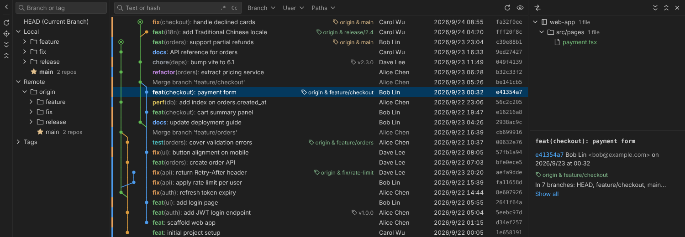

# Git Workbench

[](https://github.com/xjin9612/vscode-git-workbench/actions/workflows/ci.yml)

English | [繁體中文](README.zh-TW.md)

IntelliJ-style Git tool windows for VS Code. **Git log** in the bottom panel — Branches tree | Commit log with graph | Changed files + commit details, three linked panes — and a **Commit window** in the side bar, with first-class support for workspaces that contain many repositories.



## Features

- **Branches** — Local / Remote / Tags tree, grouped into folders by `/` (`feature/…`, `fix/…`) or by repository. Toolbar in IntelliJ's order (new, update, delete, compare, diff with working tree, fetch, favorites, navigate to branch head). Click a branch to filter the log; double-click to check it out. Star favorites to pin them (or show only favorites). Context menu: new branch from, compare with current, merge, rebase, update, push, rename, delete, push tag.
- **Commit log**
  - Commit graph with colored lanes and a HEAD marker
  - Ref labels: matching local and remote branches are merged into one label (`origin & main`), plus tags and detached HEAD
  - Filters: text or hash (regex and match-case toggles), Branch (cascading menu with favorites), User (supports `me`), Paths (repositories and folders), Date. Multiple values are separated by `|` or new lines; `Enter` completes, `Ctrl+Enter` applies. Text and User filters still draw a simplified graph
  - Several log tabs, each with its own filters
  - Highlights: Conventional Commits type coloring (`feat`, `fix`, `docs`…), bold for your own commits, dimmed merge commits
  - Columns: Author (`*` when author ≠ committer), Date, Hash — toggle them from the 👁 menu, drag their edge to resize
  - Virtual scrolling with streamed loading; tested with 100,000 commits
  - Context menu: copy hash / subject, checkout revision, new branch / tag, cherry-pick, revert, reset (soft / mixed / hard), push up to here, compare with the working tree, interactively rebase from here
  - Multi-select with `Ctrl` / `Shift`: combined changes in the right pane, cherry-pick or revert several commits at once
  - Interactive rebase: pick, reword, edit, squash, fixup, drop, reorder by drag or `Alt+↑↓`. An in-progress rebase / merge / cherry-pick shows a bar with Resolve Conflicts…, Continue, Skip and Abort
  - Issue numbers in messages become links (`gitWorkbench.issueLinks`); selecting a commit dims the rows outside its path
- **Commit window** (`Alt+0`) — check the files to commit, or pick single hunks; changelists; unversioned and ignored files; group by directory, repository or module; amend, sign-off, skip hooks, Commit and Push…; rollback, add to `.gitignore`. Commits through a temporary index, so the staging area you use in VS Code's Source Control is left alone. A Stash tab lists every repository's stashes
- **Merge conflicts** — a Conflicts tab (Accept Yours / Accept Theirs / Merge…, then Continue) and a three-way Merge tab: Yours, an editable Result and Theirs, with ≫ ✕ per change or per line (Line by Line), Apply Non-Conflicting Changes, and undo / redo. Works for merge, rebase, cherry-pick, revert and stash conflicts
- **Sync** — Fetch in the Branches toolbar, Pull and Push in the log toolbar. Push always opens a Push Commits dialog (in an editor tab) listing what will be pushed; Force Push (`--force-with-lease`) is in the dialog's drop-down. Push All up to Here… pushes only up to a chosen commit. Local branches show ↑ahead ↓behind in the Branches tree
- **Changed files** — tree (or flat list), grouped by directory, repository or module, with file-type icons and file counts; added in green, modified in blue, deleted in gray. Double-click (or `Enter`) opens VS Code's native diff; step to the previous / next file with ← → in the diff's title bar.
- **Commit details** — full message, author / committer, refs, and the branches that contain the commit
- **Open it your way** — Git Workbench icon in the Activity Bar, "Git Log" in the status bar, or `Alt+9`
- **Show Git History** from the Explorer or editor context menu — jumps to the file's repository and filters by its path. The Explorer's Git Workbench submenu also has Compare with Branch or Tag…, Stash Changes… and Unstash Changes…
- **Git console** — every git command, its output and the reason it failed, in the Output panel's *Git Workbench* channel (button in the log panel's title bar)
- **Toggle Git Blame** in the editor context menu switches VS Code's built-in blame annotations
- English and Traditional Chinese UI, switchable on its own with `gitWorkbench.language`
- Refreshes automatically when branches, tags or HEAD change

## Multiple repositories

- Scans each workspace folder for repositories (`gitWorkbench.scanDepth`, `gitWorkbench.scanExclude`), including folders that are not repositories and repositories nested inside other repositories
- Commits from all repositories are merged by time into one log; each repository gets its own graph lanes and a color strip on the left (hover to see its name)
- **Paths** filter: check repositories under Roots (`Ctrl+click` for just one), or Select Folders… to pick folders across repositories (like IntelliJ's multi-root Paths filter)
- Click the color strip to show a repository-name column
- The **Repositories** view in the side bar stays in sync with the Paths filter
- Branches with the same name across repositories are merged into a single entry — double-click to check it out in all of them at once
- Fetch / Pull / Push run on every repository visible under the Paths filter, with one combined summary

## Keyboard (in the log)

| Key | Action |
|---|---|
| `↑` `↓` `PageUp` `PageDown` `Home` `End` | Move the selection |
| `Shift+↑↓`, `Ctrl`/`Shift`+click, `Ctrl+A` | Select several commits |
| `Ctrl+C` | Copy the selected commit hash |
| `Ctrl+F` | Focus the search box |
| `Esc` (in the search box) | Clear the text filter |
| `Alt+9` (anywhere) | Show the Git log |
| `Alt+0` (anywhere) | Show the Commit window |
| `Ctrl+Enter` (in the commit message) | Commit |
| `Ctrl+Alt+PageUp` / `Ctrl+Alt+PageDown` (in a diff) | Previous / next changed file |

## Large repositories

The log loads 50,000 commits of a 100,000-commit repository in about a second. Git's commit-graph file makes it faster still: in our measurements the first screen appeared in about 0.1 s instead of 0.6 s, and filtering by a file path took about 0.2 s instead of 1.2 s.

Git usually writes a commit-graph during its automatic `git gc`, but not the part that speeds up path filters. Run **Git Workbench: Optimize Repository** from the Command Palette to write the full commit-graph (`git commit-graph write --reachable --changed-paths`). It only adds a file under `.git/objects/info`, changes no commits or files, is not pushed, and also speeds up git itself and other git tools. Deleting the file undoes it.

## Settings

Most of these can be changed from the gear in the Git log's or the Commit window's title bar, and take effect immediately.

| Setting | Default | Description |
|---|---|---|
| `gitWorkbench.maxCommits` | `50000` | Maximum number of commits loaded (total across repositories, up to 200000) |
| `gitWorkbench.autoRefresh` | `true` | Refresh when refs or HEAD change |
| `gitWorkbench.scanDepth` | `3` | How many folder levels below each workspace folder are scanned for repositories |
| `gitWorkbench.scanExclude` | `node_modules`, `target`, … | Folder names skipped while scanning |
| `gitWorkbench.language` | `auto` | Language of the panel, dialogs and messages: `auto` (follow VS Code), `en`, `zh-tw` |
| `gitWorkbench.issueLinks` | `[]` | Turn issue numbers in commit messages into links, e.g. `{ "pattern": "PROJ-(\\d+)", "url": "https://tracker.example.com/browse/PROJ-$1" }`. `$1`… are capture groups, `{repo}` is the repository's web URL. When empty, `#123` links to the remote's issues page |

## Installation

Download the `.vsix` from [Releases](https://github.com/xjin9612/vscode-git-workbench/releases), then run **Extensions: Install from VSIX…** in VS Code. Reload the window after installing or updating.

Requires VS Code 1.90 or later and Git on your `PATH` (or configured through the built-in Git extension).

## Development

```bash
npm install
npm run build       # build dist/
npm run typecheck   # type-check the extension and the webview
npm test            # unit and integration tests (requires git)
npm run test:ui     # UI end-to-end tests in Chromium (first run: npx playwright install chromium)
npm run test:vscode # tests inside a real VS Code (downloads VS Code on the first run)
npm run package     # create the .vsix
```

Open this folder in VS Code and press `F5` to launch an Extension Development Host.

### Releasing

1. Bump `version` in `package.json` and add a matching section at the top of `CHANGELOG.md` (`## 1.1.0`) — it becomes the release notes
2. Commit, then tag and push: `git tag v1.1.0 && git push origin v1.1.0`
3. GitHub Actions (`.github/workflows/release.yml`) checks the version, runs the tests, packages the `.vsix`, and publishes a GitHub Release using that CHANGELOG section as the notes

The release fails if the tag does not match `package.json` or the CHANGELOG has no section for the version. Versions containing `-` (e.g. `v1.1.0-beta.1`) are published as pre-releases.

### Architecture

```
src/
  extension.ts        entry point: registers the webview view, read-only file system and commands
  provider.ts         Git log webview view: repository management, messaging, auto refresh, checkout
  commitView.ts       Commit window webview view: working-tree changes, changelists, commit
  dialogPanel.ts      dialogs opened as editor tabs: Push, Unstash, hunk selection, interactive rebase
  actions.ts          branch, commit and push actions shared by the panel and the dialogs
  i18n.ts             UI language (follows VS Code or gitWorkbench.language)
  sidebar.ts          Repositories view in the Activity Bar and the status bar item
  diffProvider.ts     git-workbench: read-only file system serving file contents at a revision for vscode.diff
  gitExtension.ts     git path and state events from the built-in Git extension
  git/                runs the git CLI and parses its output (no vscode dependency, directly testable)
  shared/             shared by extension and webview: message protocol, graph layout, ref labels, trees
  webview/            the three-pane UI (plain TypeScript + Canvas, no framework)
media/webview.css     styles; every color comes from VS Code theme variables
```

## License

[MIT](LICENSE)

Inspired by the Git tool window in IntelliJ IDEA. Not affiliated with or endorsed by JetBrains.
